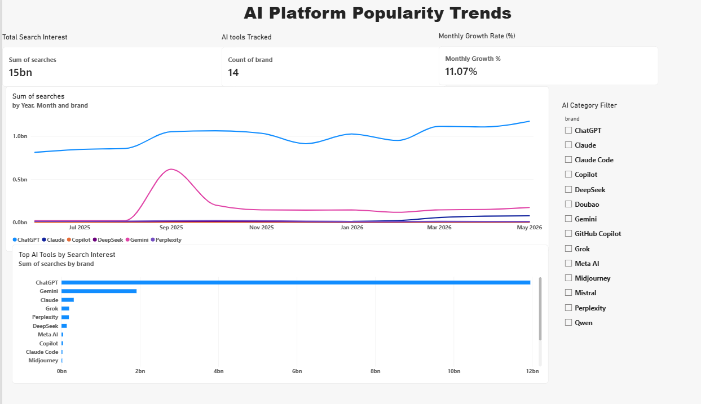

# 📊 AI Platform Popularity Trends

An interactive **Power BI dashboard** that explores search interest and monthly popularity trends across AI platforms such as ChatGPT, Gemini, Claude, Copilot, DeepSeek, and Perplexity.

## 📌 Project Overview

Artificial Intelligence tools are growing rapidly, and understanding their search popularity can help identify changing trends and user interest.

This project uses Power BI to visualize AI platform search trends over time, compare platforms, and explore their relative search interest through interactive charts and filters.

## 🎯 Objectives

- Analyze monthly search interest across AI platforms.
- Compare search interest between different AI tools.
- Track monthly growth in search interest.
- Build an interactive and visually appealing dashboard.
- Practice data transformation, visualization, and reporting using Power BI.

## 🛠️ Tools & Technologies

- **Power BI Desktop** — Dashboard development and visualization
- **Power Query** — Data loading and transformation
- **DAX** — Measures and calculations
- **CSV** — Dataset format

## 📈 Dashboard Features

- **Total Search Interest:** Displays the aggregate search metric.
- **AI Tools Tracked:** Shows the number of distinct AI tools in the selected data.
- **Monthly Growth Rate:** Displays the calculated month-over-month change.
- **AI Platform Search Trends:** A line chart comparing monthly search interest across platforms.
- **Top AI Tools by Search Interest:** A bar chart comparing platforms.
- **Category Filter:** An interactive slicer for filtering the dashboard.

## 🖼️ Dashboard Preview

<!-- Add your dashboard screenshot here after uploading it to this repository -->



## 📂 Project Structure

```text
AI-Platform-Popularity-Trends/
│
├── AI-Platform-Popularity-Trends.pbix
├── dashboard.png
└── README.md
```

Add the dataset file only if its license and sharing permissions allow redistribution.

## 🔍 Key Learnings

- Loading and transforming data in Power BI.
- Creating interactive charts, cards, and slicers.
- Writing DAX measures for analytical calculations.
- Comparing trends across multiple categories.
- Designing a dashboard for clear and effective data storytelling.

## 📊 Data Source & Methodology

**Dataset:** Monthly AI platform search-interest dataset.

**Source:** [Cleanor Search Index — Hugging Face](https://huggingface.co/datasets/cleanorlabs/cleanor-search-index)

The dashboard uses the dataset's search metrics to compare AI platforms over time. Search interest is an indicator of search demand; it should not be interpreted as actual users, website visits, or product usage.

*Note: The dataset source, metric definitions, and licensing should be verified before using the results in formal analysis.*

## 🚀 How to View the Project

1. Download the `.pbix` file from this repository.
2. Open it using Microsoft Power BI Desktop.
3. Interact with the charts and category slicer to explore the data.

## 👩‍💻 Author

**Tulasi Pallelli**

B.Tech — Information Technology

Interested in Data Engineering, SQL, data analytics, and business intelligence.

---

⭐ If you find this project useful, feel free to explore the repository!
